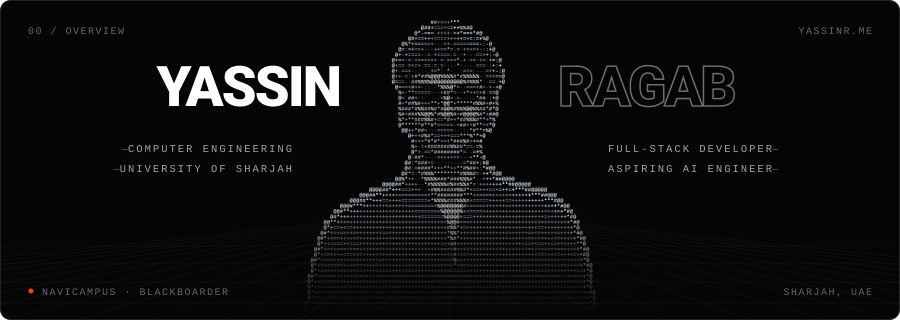

  <!-- Portfolio-Matched Hero Header (Real ASCII Portrait + Flank Typography) -->
  

    

  <!-- Monochrome / Accent Badges matching yassinr.is-a.dev -->
  
  
  
  
  

---

### `00` / Profile

I’m **Yassin Mohamed Ragab**, a Computer Engineering student at the **University of Sharjah (`2026–2030`)**, Full-Stack Developer, and Aspiring AI Engineer.

> *"I don't just write code. I build second brains."*

I engineer intelligent systems, spatial routing engines, and resilient full-stack web architectures that solve real-world friction on campus and beyond.

---

### `01` / Flagship Systems

#### ◈ [NaviCampus](https://navicampus.app/) — *Climate-Aware & Accessible Campus Navigation Engine* (`2026`)
Multi-tenant spatial mapping platform built for UAE university campuses under extreme desert heat and complex multi-floor layouts.
- **"Coolest Route" Algorithm:** Climate-aware pathfinding through air-conditioned skywalks and shaded concourses
- **"Step-Free Route" Accessibility Engine:** Strict barrier-free routing eliminating stairs and steep inclines
- **Vector Topology Compiler:** In-browser spatial canvas editor compiling multi-floor plans into single-read graph bundles
- **Zero-Latency Local Routing:** Instant client-side graph pathfinding computed with zero server overhead
- **Stack:** `TypeScript` · `Vite` · `Leaflet / Canvas` · `Firestore` · `Firebase Storage` · `Cloudflare Pages`
- **Links:** [Launch Platform](https://navicampus.app/) · [Open Web App](https://navicampus.app/app)

 

#### ◈ [Blackboarder](https://blackboarder.pages.dev/) — *Bilingual LMS Extension & Academic Companion* (`2026`)
Bilingual (Arabic + English) Manifest V3 Chrome extension and offline-first companion PWA for Blackboard Learn Ultra.
- **Bilingual NLP Parser:** Local parser extracting buried exam deadlines and room changes from Arabic & English colloquial announcements (e.g., `"الأحد بعد القادم"`) with optional hybrid AI
- **Automated Gradebook & GPA Engine:** Pulls official marks, matches syllabus weights, and projects cumulative GPA on the UOS 4.0 scale
- **Zero-Knowledge Multi-Device Sync:** Private 10-character cryptographic sync keys without accounts + server-side encrypted AI key locker
- **Live Calendar & Push:** Live `.ics` / WebCal feeds for Apple, Google, and Outlook + Web Push notifications
- **Stack:** `Chrome MV3` · `TypeScript` · `Cloudflare Pages Worker` · `Firebase RTDB` · `PWA` · `Vitest (528 tests)`
- **Links:** [Official Site](https://blackboarder.pages.dev/) · [GitHub Extension](https://github.com/yvs1n/blackboarder-extension) · [Companion App](https://blackboarder.pages.dev/companion/)

---

### `02` / Engineered Platforms

| Year | Project | Description | Links |
| :--- | :--- | :--- | :--- |
| `2026` | **Elementa** | Full-stack educational science platform with real-time progress tracking & video walkthroughs | [Live](https://elementaa.vercel.app/) · [GitHub](https://github.com/yvs1n/elementa) |
| `2026` | **British Curriculum 101** | Interactive academic resource hub featuring an integrated page summarizer | [Live](https://bc101.pages.dev/) · [GitHub](https://github.com/yvs1n/bc101) |
| `2026` | **Spy Game Companion** | Real-time multiplayer mobile web app with persistent Socket.io session handling | [Live](https://spy-game-0pla.onrender.com/) · [GitHub](https://github.com/yvs1n/spygame) |
| `2024` | **FundFair** | Interactive digital finance and community fundraising ecosystem | [Live](https://fundfair.pages.dev/) |
| `2023` | **TranZ · CodeX UAE** | National school-level web creation competition finalist platform | [Live](https://tranz.pages.dev/) · [GitHub](https://github.com/yvs1n/tranz) |
| `2023` | **SSFIM Platform** | Space settlement framework presented to Ranju Anand, SVP of Education at GEMS | [Live](https://ssfim.pages.dev/) |

---

### `03` / Capabilities & Stack

- **Languages:** `TypeScript` · `JavaScript (ES6+)` · `Python` · `HTML5` · `CSS3`
- **Frontend & Graphics:** `WebGL` · `Three.js` · `Canvas 2D` · `Leaflet` · `GSAP`
- **Cloud & Infrastructure:** `Cloudflare Pages & Workers` · `Firebase (Firestore, Storage, RTDB)` · `Node.js` · `Socket.io` · `Vite` · `Vitest`
- **AI & NLP:** Client-side NLP pipelines · `Gemini API` · Generative AI workflows · Hybrid inference systems

---

### `04` / STEM & Technical Foundation

- **University of Sharjah (`2026–2030`):** B.Sc. Computer Engineering, College of Computing & Informatics
- **Academic Honors:** `A*` in A-Level Mathematics · `8 A*/A` IGCSE Honors (Math, Physics, Chemistry, ICT) · Pearson Edexcel High Achiever
- **Pearson Edexcel Teaching Assistant:** Mentored `1,000+` students across A-Level Statistics 1 (probability, discrete random variables, normal distribution) & AS/IGCSE Physics
- **Impact Metrics:** `15+` deployed web & AI architectures · `500,000+` digital reach (including GenAI photo restoration & Google Calendar automation workflows)
- **Certifications:** Google AI for Educators · Microsoft Innovative Educator · Cloud Computing (Great Learning) · AI Tools for Infrastructure (Arab Academy) · Metahack Coding

---

### `05` / Transmission & Contact

- **Interactive Portfolio & Digital Twin:** [yassinr.is-a.dev](https://yassinr.is-a.dev/)
- **Personal Email:** [yassinraggab@gmail.com](mailto:yassinraggab@gmail.com)
- **Work Email:** [yassin@navicampus.app](mailto:yassin@navicampus.app)
- **LinkedIn:** [linkedin.com/in/yassinr](https://linkedin.com/in/yassinr)
- **Curriculum Vitae (PDF):** [yassinr.is-a.dev/cv.pdf](https://yassinr.is-a.dev/cv.pdf)
- **GitHub:** [github.com/yvs1n](https://github.com/yvs1n)
