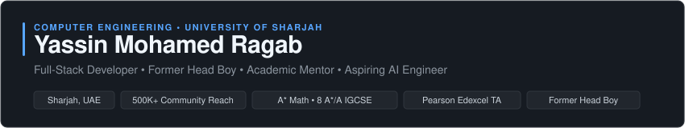

  <!-- Clean Editorial Header -->
  

    

  <!-- Verified Badges -->
  
  
  
  
  
  

---

### 👋 Hey, I’m Yassin

I am a Computer Engineering freshman at the **University of Sharjah** and a full-stack developer.

Most of what I build starts as a real-world friction point (manual workflows, scattered study resources, or repetitive tasks) and turns into clean, automated software products. I’m particularly drawn to full-stack web architectures, real-time WebSocket systems, and practical AI tooling.

---

## 🚀 Projects & Shipped Systems

### 🧠 [Elementa](https://elementaa.vercel.app/)
A full-stack educational platform built to bring clarity and structure to coursework with persistent progress tracking and walkthrough video engines.
- Focus: modular revision architecture, client-side session caching, and responsive UI  
- Stack: JavaScript (ES6+), Modern Vanilla CSS, Vercel  
- Links: [Live Demo](https://elementaa.vercel.app/) • [Source Code](https://github.com/yvs1n/elementa)

---

### 📚 [British Curriculum 101 (BC101)](https://bc101.pages.dev/)
An interactive academic resource hub for IGCSE & A-Level students, featuring an integrated in-browser study summarizer.
- Built to eliminate the friction of hunting across fragmented exam board portals  
- Built-in client-side summarizer engine to condense heavy syllabus sections during revision  
- Scaled to thousands of visits across the UAE and GCC  
- Links: [Live Hub](https://bc101.pages.dev/) • [Source Code](https://github.com/yvs1n/bc101)

---

### 🌐 [TranZ — CodeX UAE](https://tranz.pages.dev/)
Finalist platform in the CodeX UAE national school-level web creation competition, built around high-contrast kinetic layout principles and responsive web standards.
- Recognition: National competition finalist  
- Links: [Live Demo](https://tranz.pages.dev/) • [Source Code](https://github.com/yvs1n/tranz)

---

### 🕹️ [Spy Game Companion](https://spy-game-0pla.onrender.com/)
A real-time mobile web companion app for social deduction games, built around zero-latency synchronized rooms.
- Architecture: Node.js, Express, and Socket.io for persistent room matchmaking and distributed game state broadcasting  
- Links: [Live App](https://spy-game-0pla.onrender.com/) • [Source Code](https://github.com/yvs1n/spygame)

---

### ⚡ Developer Tooling & Automation
- **LMS Workflow Tooling ([Blackboarder](https://github.com/yvs1n/blackboarder-extension)):** Chrome extension and batch download scripts to bypass repetitive clicks and organize course files.  
- **Calendar & Data Automation:** Automated student schedule and milestone triggers via a custom Google Calendar pipeline.  
- **GenAI Workflows:** Engineered batch image restoration and linearization pipelines.  
- **Freelance Tooling:** Custom Google Chrome themes and web styling projects on Fiverr ($150+ revenue).

---

## 🧠 Technical & STEM Highlights

- 🏆 **Finalist — CodeX UAE** National Web Creation Competition (2023)  
- 📐 **Academic Foundation:** A* in A-Level Mathematics • 8 A*/A in IGCSEs (Math, Physics, Chemistry, ICT)  
- 👨‍🏫 **Pearson Edexcel Teaching Assistant:** Statistics 1 (probability, discrete random variables, distributions) & Physics AS/IGCSE  
- 📜 **Technical Certifications:** Google AI for Educators, Microsoft Innovative Educator, Cloud Computing (Great Learning), AI Tools for Infrastructure (Arab Academy)  
- 💻 **Metahack Coding** — Participant  

---

## 🧰 Tech Stack
*Pragmatic, not ideological. I choose a tech stack depending on performance, requirements, and system conditions.*

- **Languages:** JavaScript (ES6+), TypeScript, Python, HTML5, Modern CSS3  
- **Frontend & UI:** Responsive Web, DOM APIs, Canvas / WebGL experimentation, Tailwind CSS  
- **Backend & Real-Time:** Node.js, Express, Socket.io (WebSockets), REST APIs  
- **Cloud & AI:** Gemini API, Cloud Firestore, Firebase, Serverless (Vercel, Cloudflare Pages, Render)  
- **Tooling:** Git, Linux, Chrome Extensions (Manifest V3), Vite  

---

## 🔍 How I Work

- **Solve Real Friction:** Systems over repetitive tasks — if something has manual friction, write a script or build a tool to solve it.  
- **First-Principles Understanding:** Strong grasp of core math, data flow, and networking before reaching for heavy abstractions.  
- **Fast Iteration:** Build working prototypes rapidly, deploy to production, and iterate based on real usage.  
- **Pragmatic & Lightweight:** Keep architectures maintainable, fast, and dependency-light.  

---

## 🎯 Direction

- Deepen Computer Engineering foundations (systems programming, hardware-software boundary, distributed architectures).  
- Build and ship developer utilities, browser tools, and micro-SaaS products.  
- Use AI as a core development and productivity layer.  
- Continue contributing to open-source software and shipping tools that people actually use.  

---

## 📫 Contact

- 🌐 Website: [yassinr.me](https://yassinr.me)  
- 💼 LinkedIn: [linkedin.com/in/yassinr](https://linkedin.com/in/yassinr)  
- 📧 Email: [yassinragab2008@gmail.com](mailto:yassinragab2008@gmail.com)  
- 📄 Resume / CV: [Download PDF](https://yassinr.me/cv.pdf)  
- 🐙 GitHub: [github.com/yvs1n](https://github.com/yvs1n)  
